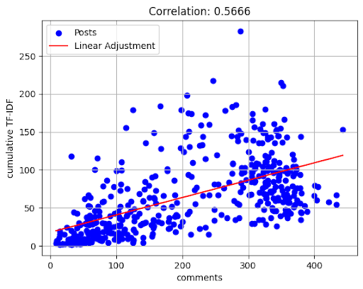
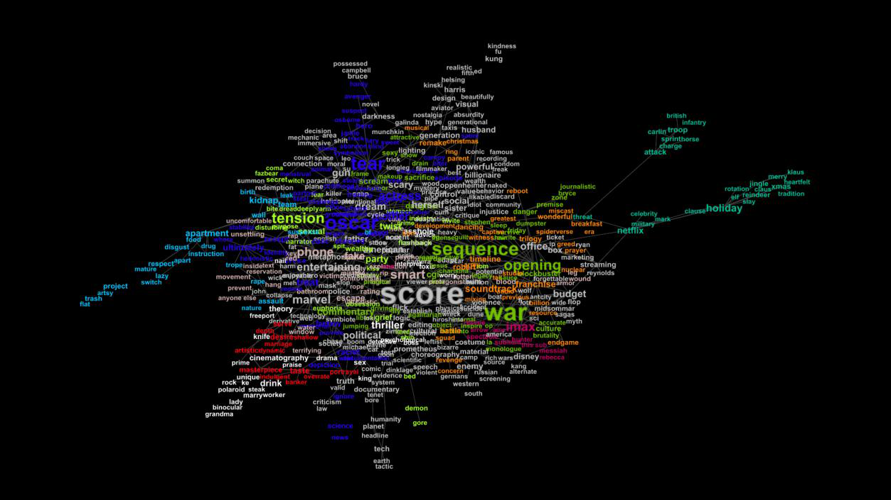

# Reddit Film Discussions: Participation and Community Structure

**Completed collaborative academic project — Social Network Analysis, University of Padua**

## Objective

Investigate how participation relates to collective language, interaction depth and connectivity across Reddit film discussions.

The study selected 100 films released between January 2019 and January 2025. Available discussion coverage varied across films.

## Methods and tools

The team used Python, Pandas and Gephi to prepare data, calculate participation metrics, examine user overlap and explore semantic networks.

Collective language was measured using TF-IDF scores for plural pronouns and affiliation-related vocabulary.

## Key findings

- Participation was moderately associated with collective-language scores (r ≈ 0.57).
- Comment volume had little association with reply-based interaction (r ≈ 0.04).
- Semantic communities were weakly separated, limiting conclusions about topic structure.

These are observational associations, interpreted within the study’s sampling and methodological limitations.

## Methodology

1. Select film-related Reddit discussions and prepare post, comment and user-level data with Python and Pandas.
2. Calculate participation and interaction indicators; use TF-IDF scores for collective-language markers.
3. Examine associations between participation measures and linguistic indicators.
4. Explore user-overlap and word co-occurrence networks with attention to sampling and pruning choices.

## Selected figures

### Participation and collective language

Original Figure 1a from the team report, showing a correlation of 0.5666. The x-axis is labelled “comments”; the surrounding report discusses unique commenters. Because these labels differ, this summary refers to participation generally. Linguistic scores are proxies, and correlation does not establish causation.

### Semantic network

Original Figure 6 from the team report. The network contains overlapping thematic regions and bridging terms. This visual supports the report’s cautious interpretation of weakly separated semantic communities.

## Interpretation summary

| Evidence | Interpretation |
| --- | --- |
| Participation and collective-language scores: r ≈ 0.57 | A moderate association within the observed sample. |
| Comment volume and reply-based interaction: r ≈ 0.04 | More activity does not necessarily indicate deeper interaction. |
| Overlapping semantic regions | Topic structure is less clearly separated than participation patterns. |

These observations are subject to sample coverage, snapshot timing and network-pruning choices.

## Practical relevance

The findings illustrate why community analysis should distinguish participation volume, interaction depth and expressions of belonging.

## Repository scope

This repository documents a completed team study. Source scripts, datasets and the full report are not included in this version.
